# Adaptation Strategist: architecture

How the Adaptation Strategist is built, from the Google Cloud services down to each file and data source. Written for judges, reviewers and anyone who will run or change the app. Every fact here was checked against the code in this repository, and against the live app where it says so, on 18 October 2026.

**Live app:** `https://adaptation-strategist-2026.web.app` (Firebase Hosting), which forwards to the Cloud Run service `atlas-web` in `asia-south1` (Mumbai). Repository: `github.com/harsh-108/Adaptation-Strategist`.

## 1. The app in one page

The Adaptation Strategist helps four kinds of people plan for climate risk to data centres in Japan and Asia-Pacific (JAPAC): a **data centre operator**, a **colocation and hyperscale provider**, an **enterprise tenant** and a **policy maker**. Each picks their persona at the top right and gets their own workspace, dashboard and guided flow.

It scores each place on **8 hazards** (heat, flood, water stress, grid reliability, cyclones, volcanoes, earthquakes, wildfire) for **today, 2030 and 2050** under two emissions pathways. The scores come only from measured open data. Gemini reads the user's plain-English questions, writes adaptation briefs and answers follow-ups, always grounded in that data. Every recommendation needs a named approver and lands in a tamper-evident audit trail.

| Fact | Value |
|---|---|
| Places scored | 27 JAPAC places on screen (62 hubs in the data file; places outside JAPAC are kept but not shown) |
| Real data centres mapped | 1,507 facilities from OpenStreetMap and PeeringDB |
| Data sources and services | 47 entries in the in-app source register (Glossary · Data sources): 19 measured sources built into the scores, 15 live feeds, 2 reference lists, 10 AI and Google Cloud services, 1 synthetic file |
| Hazards | 8, each scored 0 to 100 (higher is worse) |
| Scenarios | Today, plus 2030 and 2050 under SSP2-4.5 (moderate) and SSP5-8.5 (high) |
| Personas | 4, each with its own sections |
| Login | None. The team shares one workspace |
| Server code | Python 3.13, FastAPI, about 3,700 lines in `app/` (3,674) |
| Front end | Plain JavaScript single-page app, no framework and no build step |
| Hosting | Google Cloud: Firebase Hosting in front of Cloud Run, scale to zero |

## 2. System context

Who and what the app talks to on the live deployment. Solid arrows are calls the server makes; dotted arrows are loaded by the browser directly. OpenAQ and Electricity Maps' live grid carbon are wired in but switched off on the live app, and ReliefWeb runs only with an approved app name (see 3.4).

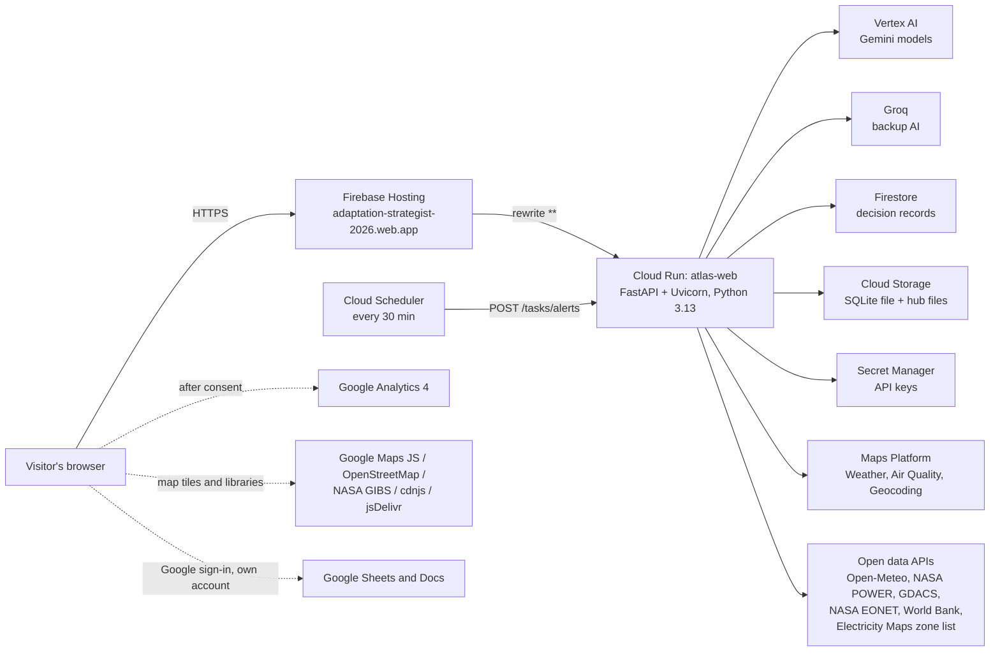

## 3. Every technology used

Only what the app uses today: **19 libraries and languages, 18 Google services and 9 outside services**. Each item was checked on 18 October 2026 against the code and, for services, against the live app (`/api/health` and real readings). Items that exist in the code but are not used are listed separately in 3.4.

### 3.1 Languages, frameworks and libraries (19)

| # | Layer | Technology | Version | What it does here |
|---|---|---|---|---|
| 1 | Server language | Python | 3.13 (set in `.python-version`) | All server code and data jobs |
| 2 | Web framework | FastAPI | 0.120.1 | API routes, middleware, static files |
| 3 | Web server | Uvicorn | 0.38.0 | Runs FastAPI (`python -m app`, from the `Procfile`) |
| 4 | HTTP client | httpx | 0.28.1 | Every outbound call: open data, Groq, Cloud Storage, Maps |
| 5 | AI SDK | google-genai | 2.31.0 | Gemini on Vertex AI (or an AI Studio key locally) |
| 6 | Numerics | NumPy | 2.4.6 | Reads the condensed data files in `scripts/derived/*.npz` |
| 7 | Database client | google-cloud-firestore | 2.x (`>=2.16,<3`) | Approvals, audit trail, meter summaries, assumptions |
| 8 | Embedded database | SQLite (Python `sqlite3`) | built in | Sites, alerts, watches, news feeds |
| 9 | Hashing | SHA-256 (`hashlib`), `hmac` | built in | Audit chain fingerprints; constant-time task-token check |
| 10 | Feed parsing | `xml.etree.ElementTree` | built in | RSS and Atom news feeds |
| 11 | Front end | HTML, CSS, JavaScript (ES2020) | none | Single-page app with a hash router (`#/work/guided`), no framework, no build step |
| 12 | Maps (open) | Leaflet, Leaflet.markercluster, Leaflet.heat | 1.9.4, 1.5.3, 0.2.0 (cdnjs) | Timelapse globe; the OpenStreetMap option of the Data centres map and its density layer; the Data centres map whenever Google Maps is unavailable. (The Hazard view map is drawn in SVG, not Leaflet.) |
| 13 | Maps (Google) | Maps JavaScript API, @googlemaps/markerclusterer | weekly, 2.5.3 (jsDelivr) | Data centres map with clusters and satellite view |
| 14 | Charts | `public/charts.js` (own SVG kit) | none | Bars, lines and gauges on the dashboards |
| 15 | Google sign-in | Google Identity Services | `accounts.google.com/gsi/client` | OAuth token for Sheets and Docs export (`drive.file` scope) |
| 16 | Analytics | gtag.js (Google Analytics 4) | none | Loaded only after the visitor allows it |
| 17 | Fonts | IBM Plex Sans, IBM Plex Mono, Schibsted Grotesk | Google Fonts | Body, numbers, headings |
| 18 | Data job extras | tifffile, h5py, xlrd | 2026.3.3, 3.16.0, 2.0.1 | Offline: STORM cyclone maps, IPCC sea level, Grid-India reports (built `storm.npz`, `sealevel.npz`, `grid_india.json`) |
| 19 | Tests | Plain Python script | none | `tests/test_strategist.py`: 63 checks on SQLite, 67 with Firestore |

### 3.2 Google Cloud and Google services (18)

| # | Service | Used for | Set up by | Live check |
|---|---|---|---|---|
| 1 | **Cloud Run** | Runs the whole app as one container (`atlas-web`) | `deploy.ps1` | Connected |
| 2 | **Cloud Build** + Google Cloud buildpacks | Builds the container from source on each deploy | `gcloud run deploy --source .` | Comes with source deploys |
| 3 | **Artifact Registry** | Stores the built container images | Automatic with source deploys | Comes with source deploys |
| 4 | **Vertex AI** (Gemini) | All AI features, through the app's service account, with no API key | `GOOGLE_GENAI_USE_VERTEXAI=true` | Connected (mode `vertex`) |
| 5 | **Firestore** (Native mode, `asia-south1`) | Approval requests, the audit trail, meter summaries, assumptions | `deploy.ps1` creates the database | Connected |
| 6 | **Cloud Storage** | Keeps the SQLite file and hub files across restarts (`gs://PROJECT-atlas/atlas/`) | `deploy.ps1` creates the bucket | Connected |
| 7 | **Secret Manager** | API keys and the task token | `deploy.ps1` copies them from `.env` | Set up by the deploy |
| 8 | **Cloud Scheduler** | Calls the alert check every 30 minutes (`atlas-alerts`) | `deploy.ps1` | Connected |
| 9 | **Firebase Hosting** | The public `web.app` address, which forwards everything to Cloud Run | `firebase deploy --only hosting` | Connected |
| 10 | **Google Analytics 4** (Firebase project) | Counts screens and features used, with consent | `GA_MEASUREMENT_ID` in `.env` | Connected |
| 11 | **IAM** service accounts | `atlas-run` runs the app with only the roles it needs | `deploy.ps1` | Set up by the deploy |
| 12 | **Cloud Logging** | Request logs and the app's own messages | Automatic | Comes with Cloud Run |
| 13 | **Weather API** (Maps Platform) | Temperature, wet-bulb, today's high; heat alerts | `GOOGLE_MAPS_API_KEY` (server key) | Answering |
| 14 | **Air Quality API** (Maps Platform) | PM2.5 now; air-quality alerts | `GOOGLE_MAPS_API_KEY` | Answering |
| 15 | **Geocoding API** (Maps Platform) | Place search | `GOOGLE_MAPS_API_KEY` | Answering |
| 16 | **Maps JavaScript API** (Maps Platform) | Google Maps on the Data centres map | `GOOGLE_MAPS_BROWSER_KEY` (browser key) | Configured |
| 17 | **Google Sheets API** | Export the impact report into the visitor's own Drive | `GOOGLE_OAUTH_CLIENT_ID` | Configured (needs the visitor's sign-in) |
| 18 | **Google Docs API** | Create a brief from the impact report in the visitor's own Drive | `GOOGLE_OAUTH_CLIENT_ID` | Configured (needs the visitor's sign-in) |

### 3.3 Services outside Google (9)

| # | Service | Used for | Key needed |
|---|---|---|---|
| 1 | Groq (`openai/gpt-oss-120b`, then `gpt-oss-20b`) | Backup AI when Gemini doesn't answer | `GROQ_API_KEY` (set on the live app) |
| 2 | Open-Meteo (forecast, air quality, flood, geocoding) | River flow; fallback for weather, air quality and place search | No |
| 3 | NASA POWER API | Warming stripes for the place in use (1991 to 2020) | No |
| 4 | GDACS, NASA EONET | Recent disasters near a place | No |
| 5 | World Bank API | Country codes and region for a searched place | No |
| 6 | OpenStreetMap tiles | Map backgrounds | No |
| 7 | NASA GIBS imagery | Timelapse satellite globe | No |
| 8 | cdnjs, jsDelivr | Map libraries loaded by the browser | No |
| 9 | Electricity Maps public zone list | The grid zone of a place, when adding a hub (Manage hubs) and in the hub data build. Live grid carbon from Electricity Maps is a separate, keyed feed and is off (see 3.4) | No |

### 3.4 In the code, but not used by the running app

| Item | Why it is not counted above |
|---|---|
| BigQuery (`google-cloud-bigquery`, `jobs/bq.py`) | An optional path in the offline data jobs. The shipped cyclone and data-centre files were built from the original downloads (they are byte-identical to the files from before the BigQuery code existed), and the server never calls BigQuery |
| Earth Engine (`earthengine-api`) | Only `jobs/check_gcp.py` signs in to confirm access; no job reads Earth Engine data |
| OpenAQ | Wired into "Conditions now", but switched off on the live app because `OPENAQ_API_KEY` isn't set |
| Electricity Maps live grid carbon | Wired into "Conditions now", but switched off on the live app because `ELECTRICITYMAPS_API_KEY` isn't set. (Its keyless zone list is used; see 3.3) |
| WattTime | Listed in `.env.example` only; no code reads it |
| ReliefWeb | Wired into recent events, but only runs when ReliefWeb has approved an app name (`RELIEFWEB_APPNAME`); not confirmed on the live app |

## 4. Google Cloud deployment

### 4.1 What runs where

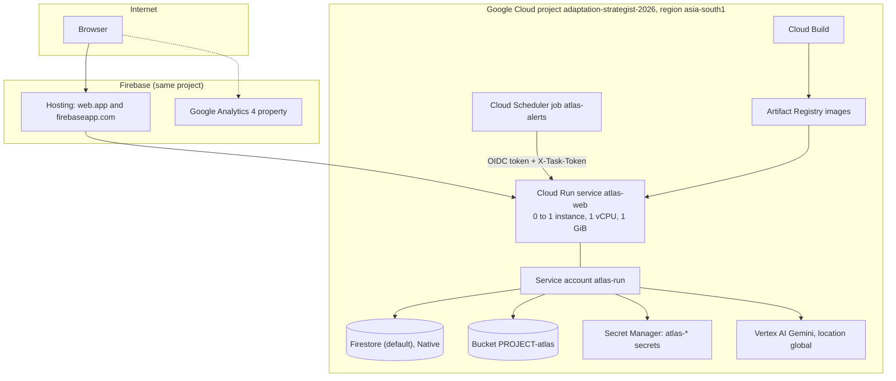

### 4.2 Cloud Run settings, and why

| Setting | Value | Reason |
|---|---|---|
| Minimum instances | 0 | Scales to zero when idle, so an idle demo costs nothing |
| Maximum instances | 1 | Sites and alerts live in one SQLite file, so there must be exactly one writer |
| CPU and memory | 1 vCPU, 1 GiB | Enough for the hazard file in memory and a site data build |
| `--cpu-boost` | on | Shorter cold starts |
| `--no-cpu-throttling` | on | The CPU stays on while an instance is up, so a site's data build and the copy to Cloud Storage finish after the request that started them |
| Request timeout | 300 s | A site's open-data build can take about 25 seconds; hub rebuilds up to 240 s |
| Access | Public (`--allow-unauthenticated`) | Hackathon demo. `-Private` switches to IAM-only access, for Identity-Aware Proxy |
| Runs as | `atlas-run@PROJECT.iam.gserviceaccount.com` | Its own minimal account, not the default compute account |

**Environment variables set by the deploy:** `GOOGLE_GENAI_USE_VERTEXAI=true`, `GOOGLE_CLOUD_PROJECT`, `GOOGLE_CLOUD_LOCATION=global`, `GCS_BUCKET`, `FIRESTORE=on`, `DEMO_LOCK_HUBS=1`, `ALLOWED_ORIGINS` (the two Firebase addresses), and, when present in `.env`: `GEMINI_MODEL`, `GROQ_MODEL`, `RELIEFWEB_APPNAME`, `ALERT_MINUTES`, `GOOGLE_OAUTH_CLIENT_ID`, `GOOGLE_MAPS_BROWSER_KEY`, `GA_MEASUREMENT_ID`.

**Secrets** the script can create (only the ones set in `.env` are created; each becomes an environment variable from `:latest`): `atlas-google-maps-api-key`, `atlas-groq-api-key`, `atlas-openaq-api-key`, `atlas-electricitymaps-api-key`, `atlas-eia-api-key`, `atlas-ember-api-key`, `atlas-task-token` (generated if missing). On the live app the Google Maps, Groq and task-token secrets are in use; the OpenAQ, Electricity Maps and EIA keys are not set, so those feeds are off or use EIA's demo key.

### 4.3 IAM: who can do what

| Account | Role | Scope | Why |
|---|---|---|---|
| `atlas-run` (the app) | `roles/aiplatform.user` | Project | Call Gemini on Vertex AI |
| `atlas-run` | `roles/storage.objectAdmin` | The bucket only | Restore and save the app's files |
| `atlas-run` | `roles/datastore.user` | Project | Read and write Firestore |
| `atlas-run` | `roles/secretmanager.secretAccessor` | Each `atlas-*` secret | Read its own keys, nothing else |
| `atlas-run` | `roles/run.invoker` | The service (only with `-Private`) | Let Scheduler call a private service |
| `PROJECT_NUMBER-compute` (build) | `roles/run.builder`, `storage.objectViewer`, `logging.logWriter`, `artifactregistry.writer` | Project | New projects no longer give the build account these, and source deploys fail without them |

Browsers get **no** Firestore access: `firestore.rules` denies every read and write. Only the server's service account, which security rules don't apply to, can reach the data.

### 4.4 Deploy pipeline (`deploy/gcp/deploy.ps1`)

One PowerShell script sets up or updates everything. It is safe to run again: existing resources are reused.

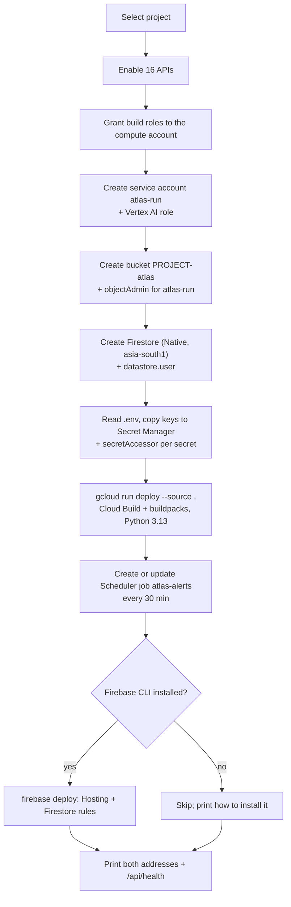

The 16 APIs: Cloud Run, Cloud Build, Artifact Registry, Secret Manager, Vertex AI, Cloud Storage, Cloud Scheduler, Firestore, Firebase, Firebase Hosting, Weather, Air Quality, Geocoding, Sheets, Docs and Maps JavaScript.

`.gcloudignore` keeps `.env`, `instance/`, `deploy/`, `docs/`, caches and Firebase files out of the uploaded source, so keys never reach Cloud Build.

### 4.5 Start-up and restarts

Cloud Run's disk is wiped at every deploy and restart. The app restores its files from Cloud Storage before it opens any of them, and stops rather than start with a blank database if the bucket can't be read.

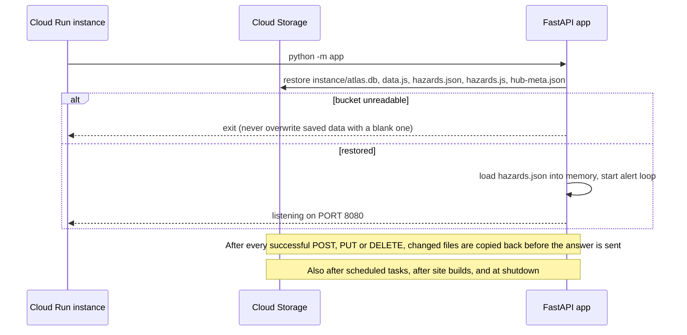

## 5. Code structure

### 5.1 Server (`app/`)

| File | Lines | Job |
|---|---|---|
| `__main__.py` | 17 | Entry point: restores from Cloud Storage, prints the AI chain, starts Uvicorn |
| `main.py` | 977 | All routes, middleware (size limit, same-origin check, demo lock, cache headers, bucket copy), rate limits |
| `settings.py` | 78 | Reads the environment and `.env`; shared constants (personas, layers, horizons, pathways) |
| `ai.py` | 150 | The AI chain: Gemini models in order, two attempts each, then Groq; labels who answered |
| `rules.py` | 347 | The rule engine: parses requests, writes briefs and answers with no AI, as the last fallback |
| `store.py` | 105 | Loads `hazards.json`; builds the evidence lines that ground every AI answer; live-reading cache |
| `scoring.py` | 36 | Overall score and risk band, matching the browser exactly (for server-side alerts) |
| `live.py` | 150 | "Conditions now": weather, wet-bulb, PM2.5, river flow, grid carbon, each with its source |
| `gmaps.py` | 57 | Google Weather, Air Quality and Geocoding calls |
| `news.py` | 284 | Recent events: GDACS, NASA EONET, ReliefWeb, admin-added RSS feeds, within 180 days |
| `alerts.py` | 249 | In-app alerts: risk-band changes and live readings over a limit; 12-hour re-fire guard |
| `sites.py` | 168 | My sites: add, edit, remove; builds each site's hazard record at its own coordinates |
| `hubs.py` | 191 | Manage hubs: add, edit and remove places, then rebuild their data |
| `governance.py` | 396 | Approvals, the hash-chained audit trail, meter summaries, pooled figures, assumptions |
| `fsdb.py` | 137 | Small store over Firestore (`get`, `list`, `put`, `transact`), plus an in-memory twin for tests |
| `gcp.py` | 145 | Cloud Storage restore and copy-back, using the metadata server's token |
| `team.py` | 27 | The single shared "team" workspace record (no login) |
| `auth.py` | 159 | SQLite connection and the legacy users table (sign-in itself is gone) |

### 5.2 Browser (`public/`)

| File | Job |
|---|---|
| `index.html` | Shell: header, persona picker, warming stripes bar, the view, and the scripts below |
| `app.js` (1,301 lines) | Everything on screen: router, personas, guided flow, decision engine, dashboards, Earth view, Impact, Glossary, source register, Ask Gemini chat |
| `analytics.js` | Consent bar and Google Analytics 4 events (short codes only) |
| `gexport.js` | Export to Google Sheets and Docs with the visitor's own Google account |
| `charts.js` | Small SVG chart kit |
| `timelapse.js` | Earth view timelapse: satellite globe with rings for Today → 2030 → 2050 |
| `data.js`, `hazards.js`, `hazards.json` | The hub list and the built hazard data |
| `samples.js` | The two fictional sample meter files, labelled as such |
| `facilities.json` | 1,507 real data centres (OpenStreetMap + PeeringDB) |
| `privacy.html` | Privacy page, with the analytics on/off switch |
| `base.css`, `app.css`, `viz.css` | Styles |

### 5.3 Data jobs (`jobs/`), run offline on a PC

| Job | Job description |
|---|---|
| `build_hazards.py` | Builds `hazards.json` for all hubs from the open sources; `--only=ID --merge` refreshes one hub (Manage hubs uses this) |
| `site_hazards.py` | Builds one site's record at its own coordinates (My sites uses this) |
| `add_hub.py` | Adds, updates or removes hubs from the command line |
| `sources/cyclones.py` | NOAA IBTrACS storm history |
| `sources/storm.py` | STORM future cyclone wind change |
| `sources/geophysical.py` | Volcanoes (Smithsonian GVP) and earthquakes (USGS) |
| `sources/wildfire.py` | NASA FIRMS vegetation fires, 2015 to 2024 |
| `sources/sealevel.py` | IPCC AR6 sea level at tide gauges |
| `sources/gridrel.py`, `gridindia.py`, `utilrel.py` | Grid reliability from the World Bank, Grid-India, EIA 861, Hydro-Québec, Taipower |
| `sources/electricity.py` | Grid carbon and national demand (Ember via Our World in Data) |
| `sources/facilities.py` | Real data centres from OpenStreetMap and PeeringDB |
| `bq.py`, `check_gcp.py` | Optional BigQuery path (with a dry-run cost check that skips any query over 200 GB) and an access check for BigQuery and Earth Engine. Not used to build the data the app ships today (see 3.4) |

Big raw downloads are condensed once into small files in `scripts/derived/` (for example `storm.npz`, `wildfire.npz`, `sealevel.npz`, `grid_india.json`), so the server never needs the raw data.

### 5.4 Other hosting in the repository

`deploy/nginx-adaptation-atlas.conf` and `deploy/adaptation-atlas.service` run the same app on a Linux server behind nginx with systemd. The app reads the same settings, and every Google Cloud feature switches off on its own when its setting is missing.

## 6. Data: sources, pipeline and scoring

### 6.1 Pipeline

Scores never come from a live call. They are built offline from measured data, condensed, and shipped with the app. Live feeds only show conditions now.

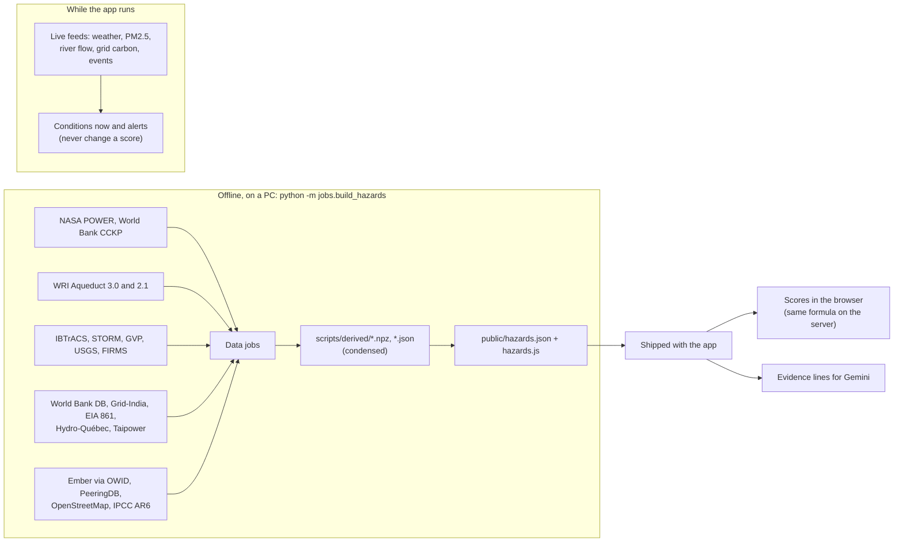

### 6.2 Scoring

- Each hazard is scored **0 to 100, higher is worse**.
- **Overall = 60% of the mean + 40% of the worst** of the hazards that have data. A hazard with no data is left out, never guessed or borrowed from a nearby place.
- **Bands:** Low under 35, Moderate 35 to 54, High 55 to 69, Severe 70 and over.
- **Scenarios:** `t` (today), `m30`, `h30`, `m50`, `h50`: 2030 or 2050 under SSP2-4.5 (moderate) or SSP5-8.5 (high).
- **Rankings** in Earth view show *climate safety* = 100 minus the score, so higher is better there.

| Hazard | How it is scored | Future |
|---|---|---|
| Heat | Hot days at or above 35 °C (150 a year = 100) and cooling degree days over 18 °C (4,000 = 100), half each, from NASA POWER 1991 to 2020 | Shifted by the World Bank CMIP6 ensemble-median warming for the country |
| Water | WRI Aqueduct 3.0 baseline water stress, area-weighted within 25 km, score 0 to 5 × 20 | Aqueduct 2.1 projected change |
| Flood | WRI Aqueduct 3.0, the worse of riverine and coastal, × 20 | Today's value carried forward, and labelled so |
| Grid | Measured outages (SAIDI and SAIFI) where the place is the measured city, or Grid-India state shortages | Today only |
| Cyclone | NOAA IBTrACS: distinct storms within 150 km (34 kt or more) and 100 km (64 kt or more) | Scaled by STORM's future-to-present ratio |
| Volcano | Holocene volcanoes within 100 km (Smithsonian GVP) | Same at every horizon |
| Earthquake | Magnitude 6+ within 300 km, 1950 to 2024 (USGS) | Same at every horizon |
| Wildfire | NASA FIRMS vegetation fires, 2015 to 2024 | Today only |

Every number on screen carries a badge: **Measured**, **Your data**, **Estimate**, **Assumption** or **No data**.

### 6.3 All data sources (the in-app register: 47 entries in five groups)

**Built into the scores (downloaded and condensed by the data jobs)**

| Source | Used for | Licence |
|---|---|---|
| NASA POWER (MERRA-2) daily max temperature, 1991 to 2020 | Heat today | Public, credit NASA LaRC POWER |
| World Bank Climate Change Knowledge Portal, CMIP6 0.25° ensemble median | Heat change to 2030 and 2050 | CC BY 4.0 |
| WRI Aqueduct 3.0 | Water today, flood today | CC BY 4.0 |
| WRI Aqueduct 2.1 projections | Water change to 2030 and 2050 | CC BY 4.0 |
| NOAA IBTrACS v04r01, 1980 to 2024 | Cyclone history | Public domain |
| STORM cyclone wind return periods (Bloemendaal et al.) | Cyclone change (high emissions) | CC BY 4.0 |
| Smithsonian Global Volcanism Program | Volcanoes | Public |
| USGS earthquake catalogue (ComCat) | Earthquakes | Public domain |
| NASA FIRMS MODIS active fires (C6.1) | Wildfire | NASA open data |
| IPCC AR6 regional sea level projections | Sea level rise (context, not scored) | CC BY 4.0 |
| World Bank Doing Business SAIDI and SAIFI | Grid reliability | CC BY 4.0 |
| Grid-India daily Power Supply Position reports | Grid reliability, Indian states | Government of India open data |
| US EIA Form 861, 2020 to 2024 | Grid reliability (US hubs) | US public domain |
| Hydro-Québec reports to the Régie de l'énergie | Grid reliability (Montréal) | Public regulatory filing |
| Taipower supply reliability index | Grid reliability (Taipei) | Published by Taipower |
| Ember, directly and via Our World in Data | Grid carbon, national electricity demand | CC BY 4.0 |
| PeeringDB facilities | Data centres nearby | PeeringDB terms |
| NASA POWER solar climatology | Solar yield | Public |
| OpenStreetMap data centre buildings | Data centres map, example sites | ODbL |
| Google Cloud region carbon data, 2025 | Enterprise tenant: region grid intensity and carbon-free energy | Apache 2.0 |

The on-screen register lists the built sources that the shipped data actually uses, so its count can be slightly lower than this table.

**Live feeds (fetched while you use the app; they never change a score)**

| Source | Used for | Fallback |
|---|---|---|
| Google Weather API | Temperature, wet-bulb, today's high; heat alerts | Open-Meteo forecast |
| Google Air Quality API | PM2.5 now; air-quality alerts | Open-Meteo air quality (CAMS) |
| OpenAQ | PM2.5 at the nearest ground station. **Off on the live app** (no key) | Row shows "off" |
| Open-Meteo flood (GloFAS) | River flow now against its 30-day median | None needed |
| Electricity Maps | Grid carbon intensity now. **Off on the live app** (no key) | Row shows "off" |
| NASA POWER API | Warming stripes for the place in use | Cached per place |
| GDACS, NASA EONET | Recent events near a place, last 180 days | Each feed is independent |
| ReliefWeb, admin-added RSS | Reports near a place. ReliefWeb runs only with an approved app name; no RSS feeds are added on the live app | Each feed is independent |
| Google Geocoding API | Place search | Open-Meteo geocoding |
| World Bank API | Country codes and region for a searched place | Typed in by hand |

**Reference lists:** the JAPAC rulebook (17 regulations, each linked to its official source, plus internal targets marked *App default*), and published data centre totals per country (Data Center Map via Visual Capitalist), used only to show how complete the map is.

**AI and Google Cloud services:** Gemini, Groq, the rule engine, Firestore, Cloud Storage, Firebase Hosting, Cloud Scheduler, Maps JavaScript API, Sheets and Docs APIs, Google Analytics 4. None of them adds numbers to the scores.

**Synthetic, clearly labelled:** two sample meter files, labelled *Fictional* on screen and never pooled. This is the only made-up data in the app.

### 6.4 Is any mock data visible in the repository?

Only the two sample meter files in `public/samples.js`, marked fictional. The example sites are real data centres. `MOCK_AI=1` is a developer switch that returns placeholder AI text for layout testing; it is off in every deploy and labelled "mock" when on.

## 7. AI design

### 7.1 The answer chain

Every AI feature tries, in order, and labels the answer with who produced it (`vertex`/`api-key`, `groq`, or `rules`):

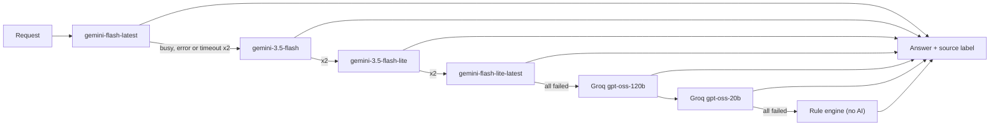

Timeout per call: 20 seconds (`AI_TIMEOUT_MS`). The model list can be changed with `GEMINI_MODEL` without touching code.

### 7.2 The four AI features

| Route | What Gemini does | Guardrails |
|---|---|---|
| `POST /api/parse` | Turns a plain-English request into app settings: persona, hazard layer, horizon, pathway, places, and intent (site, assess, compare, explore, impact) | JSON schema with enums limited to real hub ids; every field re-validated; data centre counts and MW taken only from the user's words |
| `POST /api/brief` | Writes an adaptation brief: headline, summary, two or three phases of actions, trade-offs, questions for the utility | May use only the strategies the rule engine ranked, by exact title; no invented numbers; a null score must be said as "no data" |
| `POST /api/ask` | Answers follow-up questions about one place in up to 110 words | Grounded in that place's evidence lines and sources; the last six turns of history; the question is treated as a question, never as instructions |
| `POST /api/context` | Summarises recent events in up to three cited lines | Uses only the fetched items, cited like [2]; text inside the items is treated as data |

### 7.3 Ask Gemini chat

A floating **✦ Ask Gemini** button sits at the bottom right of every screen. The conversation stays in the page and is cleared on reload.

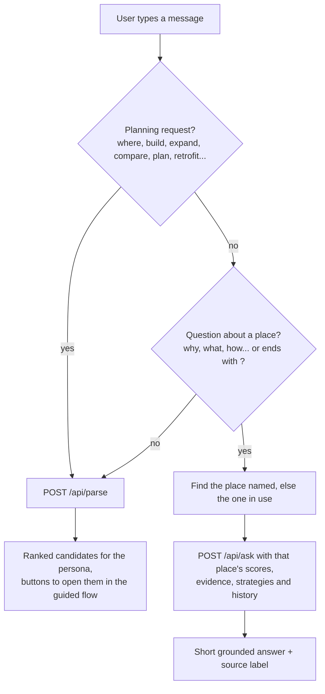

## 8. Main flows

### 8.1 Page load

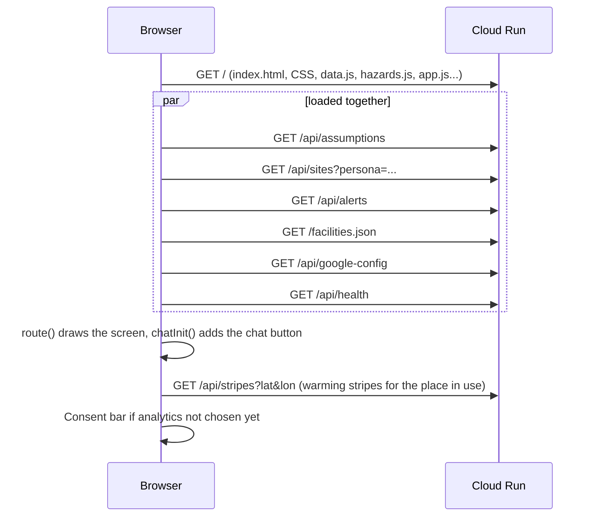

### 8.2 Guided flow, approval and audit trail

The guided flow has six steps: Persona, Inputs, Baseline, Adjust, Best fit and Approval. The last step sends the plan for approval.

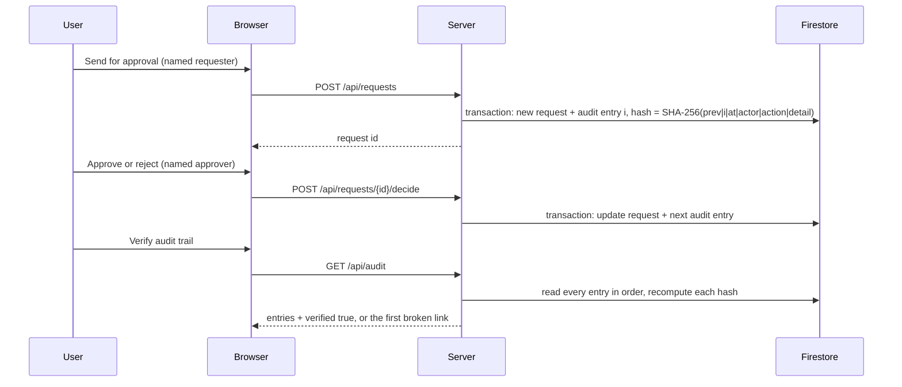

The audit trail is append-only: there is no route that edits or deletes an entry, and a changed entry breaks every hash after it. The head of the chain (`audit_i`, `audit_hash`) is kept in `meta/counters` and updated in the same transaction, so two writes can't fork it.

### 8.3 Meter files (data never leaves the browser)

The browser reads the hourly meter file itself and sends only a one-line summary: country, size group, PUE, WUE, completeness and a fingerprint of the file. The fingerprint is the Firestore document id, so a file counts once. Pooled figures for policy makers are medians per country and size group, from files at least 90% complete, and any group with fewer than **5** operators is hidden.

### 8.4 My sites

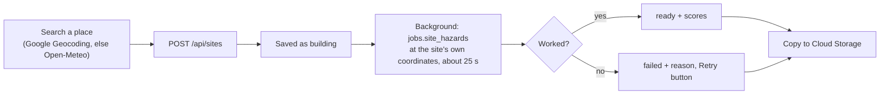

The browser checks every 5 seconds while a site is building. Builds run one at a time. Up to 100 sites.

### 8.5 Alerts

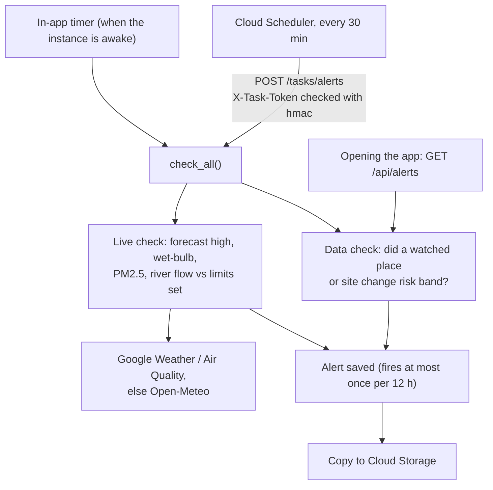

Alerts show in the app only. Nothing is emailed.

### 8.6 Export to Google Sheets and Docs

Runs entirely in the browser with the visitor's own Google account. Google Identity Services asks for the `drive.file` permission, which lets the app create and open only the files it makes. The server never sees the sign-in or the files.

### 8.7 Analytics with consent

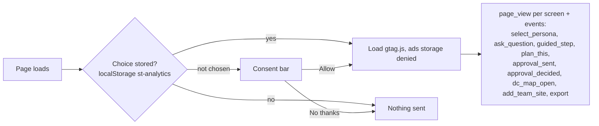

Events carry short codes only (persona, step, format, place id), never question text, names or site details.

## 9. Where data is stored

| Data | Stored in | Kept for |
|---|---|---|
| Approval requests | Firestore `requests` | Permanent |
| Audit trail | Firestore `audit` (ids `000000001`, `000000002`...) | Permanent, append-only |
| Audit chain head and counters | Firestore `meta/counters` | Permanent |
| Meter summaries (one line per file) | Firestore `meter_summaries`, keyed by file fingerprint | Permanent |
| Assumptions and their history | Firestore `assumptions`, `assumption_log` | Permanent |
| Sites, watches, alert rules, alerts, news feeds | SQLite `instance/atlas.db`, copied to `gs://PROJECT-atlas/atlas/instance/atlas.db` | Until removed |
| Hub list and hazard data | `public/data.js`, `hazards.json`, `hazards.js`, `scripts/hub-meta.json`, copied to the bucket after hub edits | Until changed |
| Warming stripes per place | Instance disk cache (`instance/stripes/`) | Until the instance restarts |
| Live readings | Server memory, 1 hour (5 minutes after a failed reading) | Until the instance stops |
| Persona, guided-flow progress, filters | Browser `localStorage` (`strategist-v1`, `st-persona`) | In that browser only |
| Analytics choice | Browser `localStorage` (`st-analytics`) | In that browser only |
| Analytics events | Google Analytics 4 property | 2 months by default |
| Chat conversation | Browser memory | Cleared on reload |
| Hourly meter readings | **Nowhere.** Read in the browser only | Never stored |
| Questions to Gemini | **Nowhere** in the app; Cloud Run's standard request logs keep the URL, not the text | About 30 days of logs |

Locally, without `FIRESTORE=on`, the governance records go into the same SQLite file instead. The first time Firestore is switched on, existing SQLite records are copied across once.

## 10. API reference

All answers are JSON. API answers are never cached; pages are revalidated on each visit. Limits are per visitor address per 10 minutes.

| Method and path | What it does | Limit |
|---|---|---|
| `GET /api/health` | What is connected: AI providers, data, Google services, demo lock | none |
| `GET /api/google-config` | Public browser settings: OAuth client id, Maps browser key, GA id, hub lock | none |
| `GET /api/live/{hub}` | Conditions now for a place | 150 |
| `GET /api/stripes?lat&lon` | Yearly mean temperature 1991 to 2020 (NASA POWER) | 150 |
| `POST /api/parse` | Plain English to settings | 40 |
| `POST /api/brief` | Adaptation brief | 40 |
| `POST /api/ask` | Follow-up answer | 40 |
| `POST /api/context` | Recent events + AI summary | 60 |
| `GET, POST /api/sites`, `PUT, DELETE /api/sites/{id}`, `POST /api/sites/{id}/refresh` | My sites | 120 |
| `GET /api/places?q` | Place search | 120 |
| `GET /api/alerts`, `POST /api/alerts/check`, `POST /api/alerts/rules`, `POST /api/watch` | Alerts and watches | 120 |
| `POST /api/alerts/read`, `DELETE /api/alerts/rules/{id}` | Mark alerts read, remove a limit | none |
| `GET, POST /api/requests`, `POST /api/requests/{id}/decide` | Approvals | 200 |
| `GET /api/audit` | Audit trail + verification | 200 |
| `POST /api/meters`, `GET /api/meters/pooled` | Meter summaries, pooled figures | 200 |
| `GET, PUT /api/assumptions` | Team assumptions | 200 |
| `GET /api/admin/status`, `/hubs`, `/lookup`, `/feeds` and their `POST`/`DELETE` | Manage hubs and news feeds (writes refused on the public demo) | 120 |
| `POST /tasks/alerts`, `POST /tasks/backup` | Scheduled jobs; need the `X-Task-Token` header | token |
| `GET /login.html` | Old sign-in page; redirects to the home page | none |

## 11. Security and privacy

| Control | How |
|---|---|
| No accounts to steal | There is no login and no password store; the team shares one workspace |
| Cross-site writes refused | Every non-GET request must come from the app's own address or the two Firebase addresses (`ALLOWED_ORIGINS`) |
| Public demo lock | `DEMO_LOCK_HUBS=1` refuses hub and news-feed edits, so nobody can break the shared hub list |
| Rate limits | Per visitor address, per feature (see section 10); requests over 100 KB refused |
| Visitor address | Only one proxy hop is trusted (`TRUST_PROXY=1`), so a forged `X-Forwarded-For` can't dodge the limits |
| Secrets | In Secret Manager, readable only by `atlas-run`; never in the repository, the build upload or the browser |
| Browser key | Restricted in the Cloud console to the site's addresses and to the Maps JavaScript API only (a console setting, not visible in the code) |
| Firestore | Rules deny every browser; only the server's service account can reach it |
| Scheduled tasks | `X-Task-Token` checked with a constant-time compare, plus a Scheduler OIDC token |
| Prompt injection | System prompts tell each model to treat user text and feed items as data; outputs are validated against schemas and enums |
| No made-up numbers | AI may quote only the evidence it is given; a missing value is said as "no data" |
| Tamper evidence | SHA-256 hash chain over the audit trail, verifiable from the app |
| Small-group privacy | Pooled meter figures hide any group with fewer than 5 operators |
| Analytics | Off until the visitor allows it; ad storage always denied; no free text sent |
| Privacy page | `/privacy.html` explains all of the above in plain words |

## 12. Fallbacks: what happens when something is down

| If this fails | The app does this |
|---|---|
| Gemini model busy or erroring | Tries the next model, twice each, then Groq, then the rule engine; the answer says which |
| Google Weather or Air Quality | Open-Meteo for the same reading |
| Google Geocoding | Open-Meteo geocoding |
| Google Maps browser key missing or refused | Leaflet with OpenStreetMap tiles |
| A live feed | That row shows "off" or "no recent reading"; others still show; failed readings retry after 5 minutes |
| Firestore | That action returns a clear 503 message; nothing half-written |
| Cloud Storage at start-up | The server refuses to start rather than run on a blank database |
| Cloud Run instance asleep | Cloud Scheduler still runs the alert check every 30 minutes |
| A site's data build | Marked failed with the reason, and a Retry button |

## 13. Cost and scaling

- **Scale to zero:** no traffic means no instance and no compute cost.
- **One instance at most:** keeps a single writer for the SQLite file. Firestore holds the records that need transactions, so the governance side would scale out unchanged; moving sites and alerts to Firestore would remove the one-instance limit.
- **Free tiers at demo traffic:** Cloud Run, Firestore, Cloud Storage, Secret Manager, Scheduler (3 jobs free), Firebase Hosting and Maps Platform's monthly caps all cover a hackathon demo. Gemini on Vertex AI is pay per use.
- **BigQuery** is not used today. If the optional path in the data jobs is switched on, each query is dry-run first and skipped above 200 GB, to stay in the free 1 TB a month.

## 14. Testing

`tests/test_strategist.py` runs the whole API against a scratch copy of the app:

```
python tests/test_strategist.py              (SQLite)
python tests/test_strategist.py --firestore  (the Firestore code path, on the in-memory store)
```

Each check prints one `PASS` or `FAIL` line. The Firestore run repeats all 63 checks on the Firestore code path (using the in-memory store in `app/fsdb.py`, not the real database) and adds 4 Firestore-only checks. All passed on 18 October 2026: **63 of 63 on SQLite, 67 of 67 with Firestore**.

| Area | Checks |
|---|---|
| No login and access control (sign-in routes gone, posts from other sites refused) | 7 |
| My sites and moving old account data to the shared team | 9 |
| Alerts | 1 |
| Approvals (names and reasons required, two-step approval, rejection, audit entries) | 14 |
| Audit-trail tampering (edited entry caught, chain verifies once restored) | 2 |
| Meter files and privacy (no double counting, groups under 5 hidden, readings never kept) | 8 |
| Assumptions (blank until set, name and source required, audited) | 7 |
| Hubs | 2 |
| Google, Firebase, analytics and privacy page | 5 |
| Allowed websites and the demo lock | 8 |
| **Total, SQLite run** | **63** |
| Firestore only: outage answers 503, first use copies SQLite records, copied chain verifies, numbering continues | +4 |
| **Total, Firestore run** | **67** |

The tests are functional, not load tests. They don't call the AI (the rule engine answers), the live Google APIs or the screens in the browser.

## 15. Known limits and next steps

- **AI speed:** answers on Vertex AI took 5 to 17 seconds in early tests. The likely cause is the first model in the chain failing on Vertex and falling through; being checked in the Cloud Run logs.
- **One instance:** see section 13.
- **Optional feeds off:** OpenAQ and Electricity Maps show "off" in Conditions now until their keys are added and the app redeployed; ReliefWeb needs an approved app name.
- **BigQuery and Earth Engine:** prepared in the data jobs but not used for the shipped data yet.
- **Grid data:** grid reliability has no open global source, so places outside the measured cities and Indian states show "No data" for grid, by design.
- **Flood future:** no open projection of flood change yet, so 2030 and 2050 carry today's flood value and say so.

## 16. Glossary

| Term | Meaning |
|---|---|
| Hub / place | A city or area scored by the app |
| Site | One of the team's own data centres, scored at its exact coordinates |
| SSP2-4.5, SSP5-8.5 | IPCC emissions pathways: moderate and high |
| PUE | Power usage effectiveness: total facility power ÷ IT power |
| WUE | Water usage effectiveness: litres of water per kWh of IT energy |
| SAIDI, SAIFI | Hours without power, and number of interruptions, per customer a year |
| Wet-bulb temperature | Combined heat and humidity; limits how well cooling works |
| Evidence lines | The plain-language data and sources given to Gemini with each question |
| Cold start | The few seconds Cloud Run takes to start an instance after it scaled to zero |
